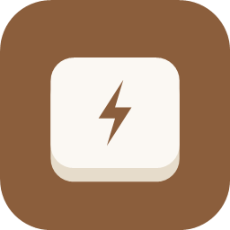

<div align="center">



# Clayboard

**Press a key. Anything happens.**<br>
Global hotkeys and macros for Windows that type text, launch apps, control media, and more.


[English](#english) · [ภาษาไทย](#ภาษาไทย)

</div>

---

<a id="english"></a>

## ✨ What it is

Clayboard sits in the tray and listens for your shortcuts, in any app. Each shortcut runs an **action**: type a saved prompt, open a program, close one, press other keys, play/pause music, or chain several steps into a **macro**.

## 🔥 Highlights

| | Feature | What you get |
|---|---|---|
| ⌨️ | **Flexible triggers** | Normal press, **double-tap**, **hold**, or **sequences** like `Ctrl+K, Ctrl+B` |
| 📝 | **Type text** | Saved prompts and snippets in any language (sent as Unicode, so the keyboard layout doesn't matter) |
| 🔐 | **Secret text** | Passwords and keys encrypted with Windows DPAPI: only your account on that PC can read them |
| 🧩 | **Macros** | Chain steps: type → wait → press keys → open app… |
| 🚀 | **Run & close apps** | Launch, close, or **toggle** a program with one key |
| 🎵 | **Media keys** | Play/pause, next, previous, volume, mute |
| 🎯 | **Per-app profiles** | A shortcut can work only while a chosen app is in front |
| 🛡️ | **Safe by default** | Bindings that came from outside the app stay paused until you allow them |
| 💾 | **One-file backup** | Export bindings **and every setting** to one file, import on a new PC |
| 🎨 | **21 themes** | Plus "follow Windows". Switches instantly, no restart |
| 🌏 | **6 languages** | English, ไทย, 日本語, 한국어, 中文, Русский |

## 💡 Ideas

- `Ctrl+Alt+1` → type your go-to AI prompt
- Double-tap `Shift` → open your notes app, press again to close it
- `Ctrl+K, Ctrl+M` → mute, wait 200 ms, type "brb" and press Enter
- Hold `CapsLock` → play/pause music, only while the browser is in front

> 🆘 **Panic switch:** `Ctrl+Alt+Shift+Pause` pauses or resumes every hotkey at once.

## 🛠️ Build

Requires the **.NET 10 SDK** on Windows.

```bash
dotnet build
dotnet run
```

**Single-file portable exe** → `dist/Clayboard/Clayboard.exe`

```bash
dotnet publish -p:PublishProfile=Portable
```

**Installer** → `dist/Clayboard-Setup.exe` (needs [Inno Setup 6](https://jrsoftware.org/isinfo.php))

```bash
"/c/Program Files (x86)/Inno Setup 6/ISCC.exe" installer/Clayboard.iss
```

The version lives in `Clayboard.csproj` (`<Version>`), and the installer reads it from the exe.

## 📂 Where settings live

| Mode | File |
|---|---|
| Installed | `%AppData%\Clayboard\config.json` |
| Portable | `config.json` next to the exe (its presence turns portable mode on) |

## 🗂️ Project map

```
Actions/       what a hotkey does (type, run, close, media, macro…)
Core/          hotkey engine, key combos, trigger modes, models
Input/         keyboard hook, sending keys, foreground app, launching
Config/        config.json, DPAPI secrets, trust list, start with Windows
UI/            WPF windows, themes, list, editor, tray icon
Localization/  UI strings for the 6 languages
installer/     Inno Setup script
```

---

<a id="ภาษาไทย"></a>

## ✨ คืออะไร

Clayboard รันซ่อนอยู่ใน tray แล้วคอยฟังปุ่มลัดของคุณ ใช้ได้ในทุกโปรแกรม แต่ละปุ่มลัดสั่ง **action** ได้ เช่น พิมพ์ prompt ที่บันทึกไว้, เปิดโปรแกรม, ปิดโปรแกรม, กดปุ่มอื่นแทน, เล่น/หยุดเพลง หรือต่อหลายขั้นเป็น **macro**

## 🔥 จุดเด่น

| | ความสามารถ | ได้อะไร |
|---|---|---|
| ⌨️ | **วิธีกดหลากหลาย** | กดปกติ, **กดสองครั้ง**, **กดค้าง** หรือ **กดต่อกันเป็นชุด** เช่น `Ctrl+K, Ctrl+B` |
| 📝 | **พิมพ์ข้อความ** | prompt หรือข้อความที่ใช้บ่อย ภาษาไหนก็ได้ ไม่ขึ้นกับ keyboard layout |
| 🔐 | **ข้อความลับ** | รหัสผ่านหรือ key เข้ารหัสด้วย Windows DPAPI อ่านได้เฉพาะบัญชีคุณบนเครื่องนั้น |
| 🧩 | **Macro** | ต่อหลายขั้น: พิมพ์ → รอ → กดปุ่ม → เปิดโปรแกรม… |
| 🚀 | **เปิด/ปิดโปรแกรม** | เปิด ปิด หรือ **สลับเปิด-ปิด** ด้วยปุ่มเดียว |
| 🎵 | **ปุ่ม media** | เล่น/หยุด, เพลงถัดไป, ก่อนหน้า, เสียงดัง-เบา, ปิดเสียง |
| 🎯 | **Profile ตามโปรแกรม** | ให้ปุ่มลัดทำงานเฉพาะตอนโปรแกรมที่เลือกอยู่หน้าสุด |
| 🛡️ | **ปลอดภัยไว้ก่อน** | ปุ่มลัดที่มาจากนอกแอปจะหยุดไว้จนกว่าจะกดอนุญาต |
| 💾 | **Backup ไฟล์เดียว** | Export ปุ่มลัด **และ setting ทั้งหมด** เป็นไฟล์เดียว ย้ายเครื่องง่าย |
| 🎨 | **21 ธีม** | และแบบตาม Windows เปลี่ยนแล้วเห็นผลทันที ไม่ต้องเปิดใหม่ |
| 🌏 | **6 ภาษา** | English, ไทย, 日本語, 한국어, 中文, Русский |

## 💡 ตัวอย่างการใช้

- `Ctrl+Alt+1` → พิมพ์ prompt AI ที่ใช้ประจำ
- กด `Shift` สองครั้ง → เปิดโปรแกรมจดโน้ต กดอีกทีเพื่อปิด
- `Ctrl+K, Ctrl+M` → ปิดเสียง, รอ 200 ms, พิมพ์ "brb" แล้วกด Enter
- กด `CapsLock` ค้าง → เล่น/หยุดเพลง เฉพาะตอนอยู่ใน browser

> 🆘 **ปุ่มฉุกเฉิน:** `Ctrl+Alt+Shift+Pause` หยุดหรือเปิดปุ่มลัดทั้งหมดทันที

## 🛠️ Build

ต้องมี **.NET 10 SDK** บน Windows

```bash
dotnet build
dotnet run
```

**exe ไฟล์เดียวแบบ portable** → `dist/Clayboard/Clayboard.exe`

```bash
dotnet publish -p:PublishProfile=Portable
```

**ตัวติดตั้ง** → `dist/Clayboard-Setup.exe` (ต้องมี [Inno Setup 6](https://jrsoftware.org/isinfo.php))

```bash
"/c/Program Files (x86)/Inno Setup 6/ISCC.exe" installer/Clayboard.iss
```

เลข version อยู่ใน `Clayboard.csproj` (`<Version>`) ตัวติดตั้งอ่านจาก exe เอง

## 📂 Setting เก็บที่ไหน

| แบบ | ไฟล์ |
|---|---|
| ติดตั้ง | `%AppData%\Clayboard\config.json` |
| Portable | `config.json` ข้าง exe (มีไฟล์นี้ = เปิดโหมด portable) |

## 🗂️ โครงสร้างโปรเจค

```
Actions/       ปุ่มลัดทำอะไร (พิมพ์, เปิด, ปิด, media, macro…)
Core/          hotkey engine, key combo, วิธีกด, models
Input/         keyboard hook, ส่งปุ่ม, โปรแกรมหน้าสุด, เปิดโปรแกรม
Config/        config.json, ข้อความลับ DPAPI, รายการที่อนุญาต, เปิดพร้อม Windows
UI/            หน้าต่าง WPF, ธีม, รายการ, หน้าแก้ไข, ไอคอน tray
Localization/  ข้อความ UI ทั้ง 6 ภาษา
installer/     script Inno Setup
```
